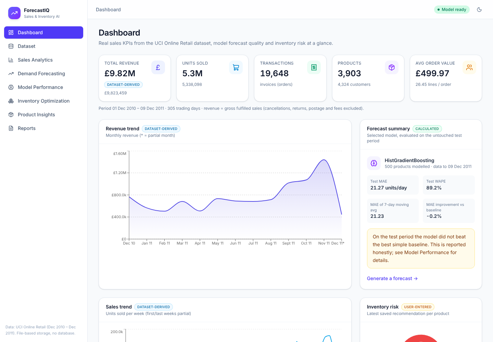
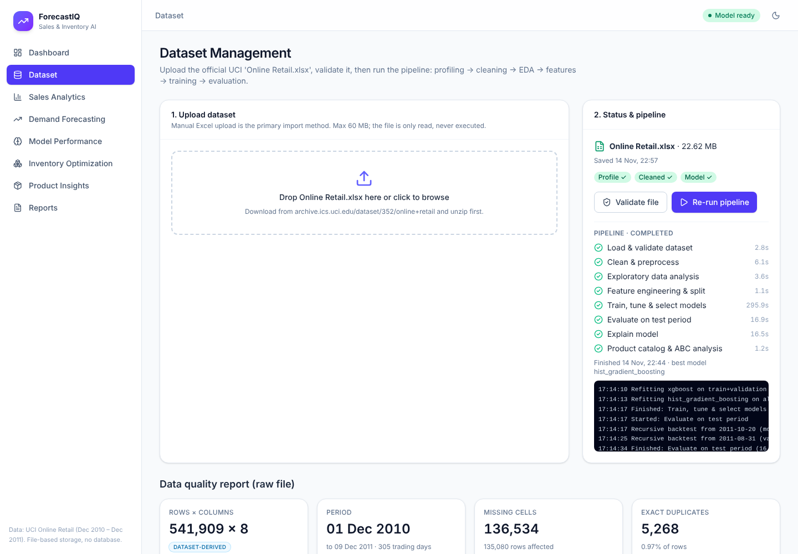
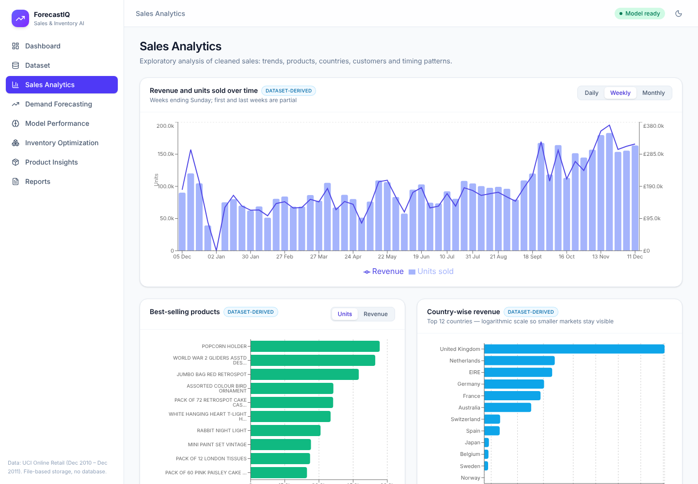
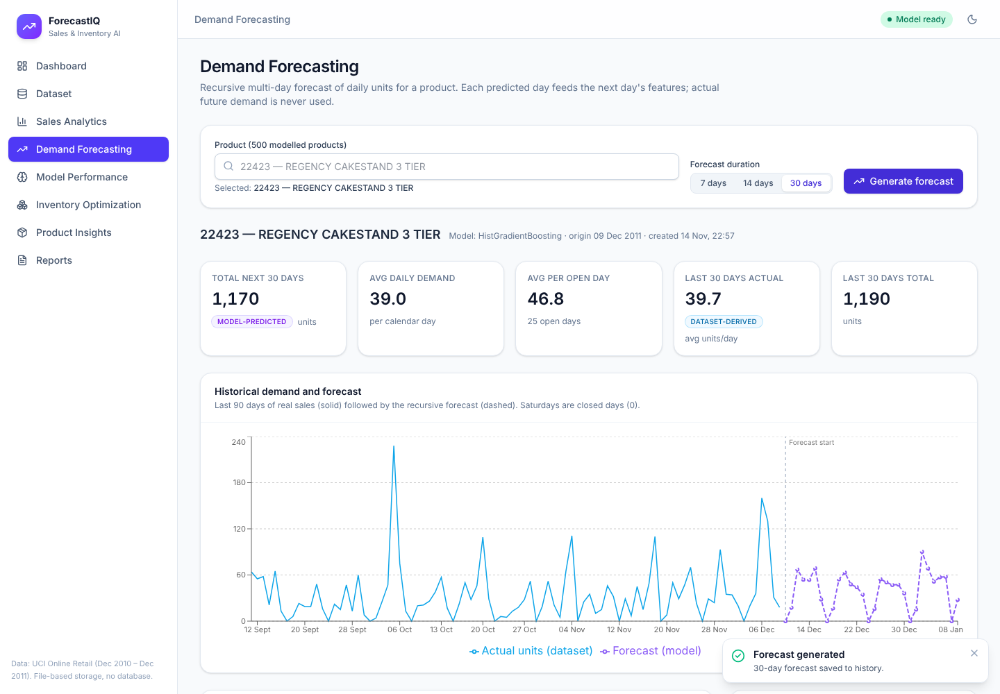
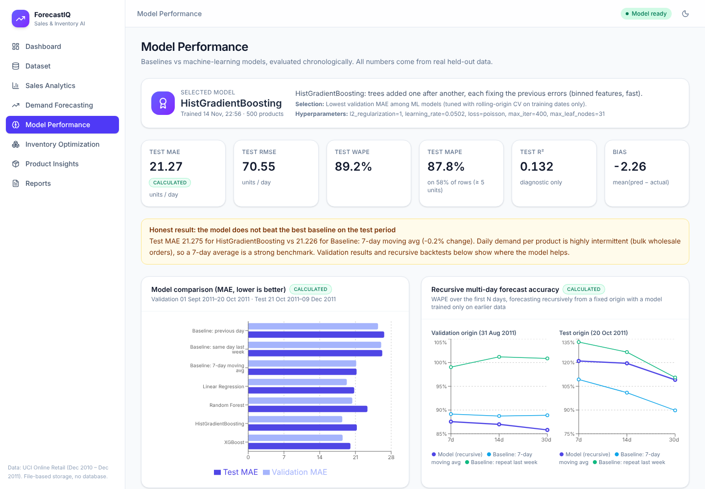
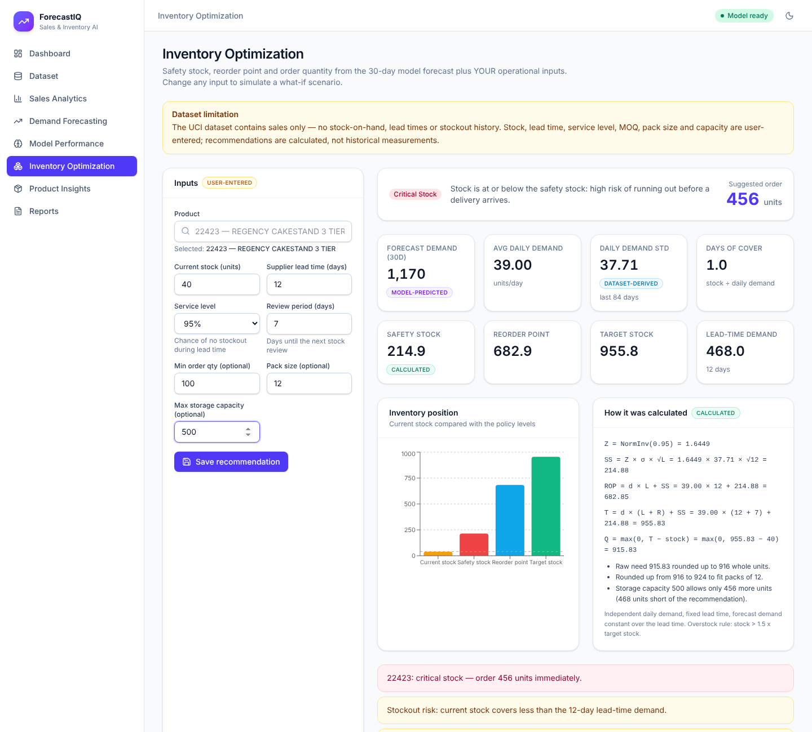
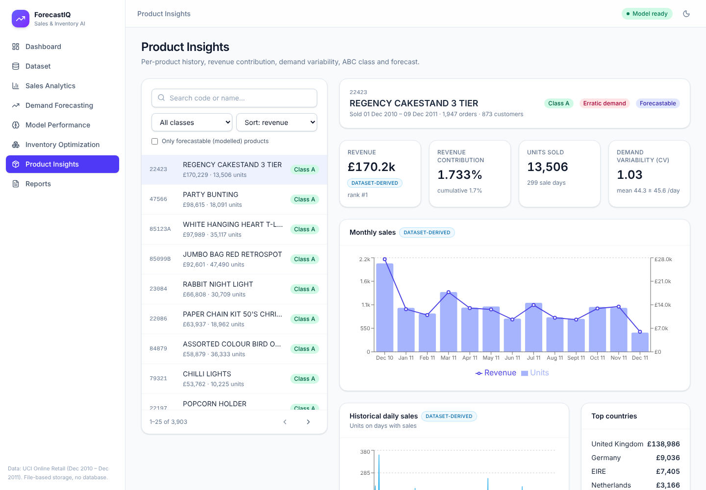
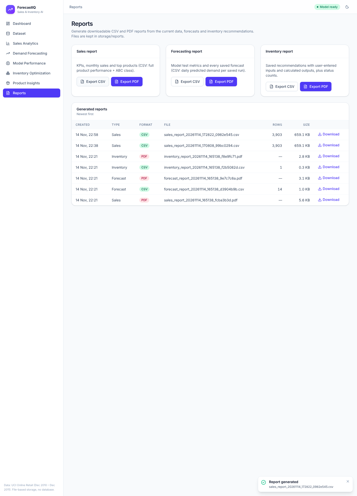
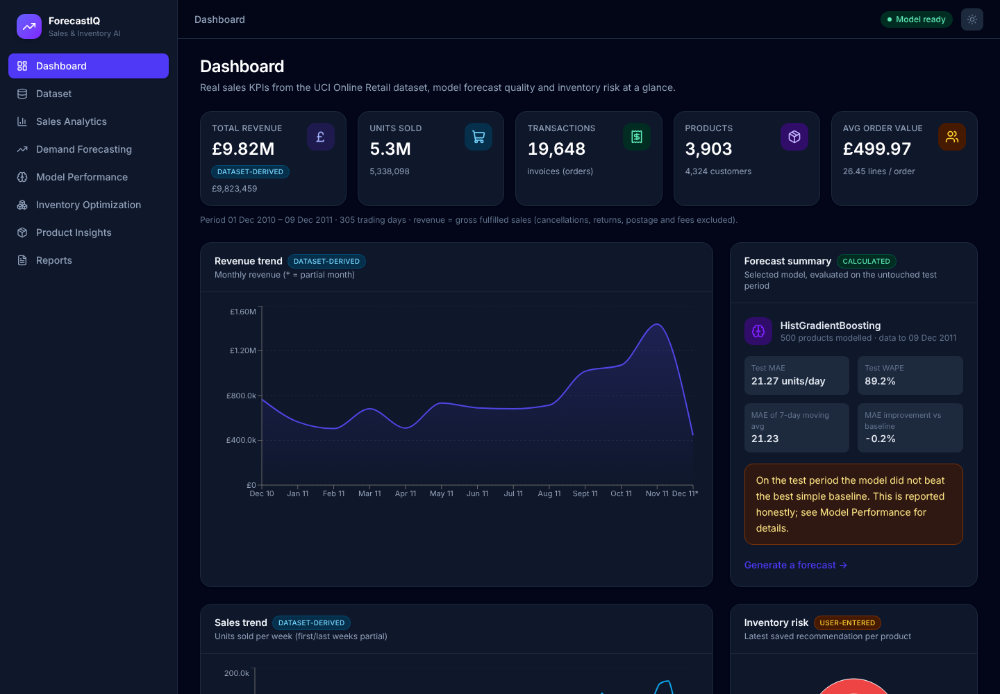

# ForecastIQ: AI-Based Sales Forecasting and Inventory Optimization System

An end-to-end retail analytics platform built on the **real UCI Online Retail dataset** (541,909 transactions, Dec 2010 – Dec 2011).
It cleans and explores the data, trains and compares demand-forecasting models with leakage-safe chronological evaluation,
produces 7/14/30-day forecasts, and turns them into safety stock, reorder point and order-quantity recommendations.
You use it through a FastAPI backend and a React dashboard.

**No database is used anywhere.** Storage is files only: CSV, JSON, Parquet and Joblib.

> B.Tech CSE (AI & ML) Project-Based Learning project. All reported numbers come from real runs. See
> [`docs/PROJECT_REPORT.md`](docs/PROJECT_REPORT.md), which is generated from the saved results.



### Screenshots
| | |
|---|---|
|  **Dataset management** |  **Sales analytics** |
|  **Demand forecasting** |  **Model performance** |
|  **Inventory optimization** |  **Product insights** |
|  **Reports** |  **Dark theme** |

---

## Features

| Area | What you get |
|---|---|
| Dataset | Excel upload with validation (type, size, real Excel signature, required columns), dataset profile, missing values, duplicates, preview |
| Cleaning | Every row labelled (sale, return, reversed order, postage/fees, adjustments...), traceable row accounting, outlier investigation |
| EDA | Daily/weekly/monthly trends, best and slow sellers, countries, customers, weekday/hour patterns, demand variability, data-driven interpretations |
| ML | Product-day panel, 27 leakage-safe features, date-based 70/15/15 split, 3 baselines + Linear Regression, Random Forest, HistGradientBoosting, XGBoost, rolling-origin tuning |
| Evaluation | MAE, RMSE, WAPE, safe MAPE, R², bias; actual vs predicted; residuals; error by product/weekday; recursive multi-day backtests |
| Explainability | Permutation importance, feature families, business-language explanations |
| Forecasting | Recursive 7/14/30-day forecasts per product, weekly summary, history comparison, saved forecast history |
| Inventory | Safety stock, reorder point, target stock, order quantity with MOQ / pack size / capacity, statuses, alerts, live what-if simulation |
| Analytics | ABC analysis, product insights, inventory risk summary |
| Reports | Sales, forecasting and inventory reports as CSV and PDF |
| Engineering | Modular FastAPI (routes → services), Pydantic validation, atomic file writes, background training, 82 pytest + 10 Vitest tests |

## Tech stack
Python · pandas · NumPy · scikit-learn · XGBoost · Matplotlib · Seaborn · Joblib · FastAPI · Pydantic · Uvicorn ·
React · TypeScript · Vite · Tailwind CSS · Recharts · Lucide React · React Router · Axios · pytest · Vitest

---

## 1. Requirements
- **Python 3.10 or newer** (3.11 or 3.12 recommended)
- **Node.js 22 LTS** (22.22 or newer, includes npm). Vite needs Node 20.19+; the frontend test tools need Node 22
- About 2 GB of free disk space and 4 GB of RAM (8 GB recommended)

## 2. Get the dataset
1. Open https://archive.ics.uci.edu/dataset/352/online+retail and click **Download**.
2. Unzip it to get **`Online Retail.xlsx`** (~23 MB).
3. Either copy it to `data/raw/Online Retail.xlsx` (exact name, including the space), **or** upload it later from the
   dashboard's **Dataset** page.

The dataset is not committed to Git (see `.gitignore`).

## 3. Install (Windows: Command Prompt or PowerShell)
```bat
cd AI-Sales-Forecasting-Inventory
python -m venv .venv
.venv\Scripts\activate
pip install -r requirements.txt

cd frontend
npm install
cd ..
```
On macOS or Linux, use `source .venv/bin/activate` instead of `.venv\Scripts\activate`.

> **Ready-to-demo ZIP:** the ZIP already contains the trained model (`artifacts/`), the processed files the dashboard needs
> (`data/processed/*.parquet`) and all reports, produced from the real dataset. You can therefore start the backend and frontend
> (steps 5–6) and use every page straight away. To reproduce everything from scratch, place the dataset (step 2) and run step 4.

## 4. Run the ML pipeline (once)
From the project root, with the virtual environment active:
```bat
python -m ml.pipeline
```
It runs every stage (validate → clean → EDA → features → train/tune → evaluate → explain → ABC), takes about 6–8 minutes on a
laptop, and writes:
- `data/processed/`: cleaned sales (CSV + Parquet), panel, features, test predictions
- `data/reports/`: JSON/Markdown reports and PNG charts
- `artifacts/`: `demand_model.joblib`, `model_metadata.json`, `feature_columns.json`, `best_params.json`, `feature_importance.json`
- `storage/products/products.json`: product catalog with ABC classes

You can also skip this step and click **Run pipeline** on the Dataset page instead. Individual stages can be run on their own:
`python -m ml.data_loader`, `python -m ml.preprocessing`, `python -m ml.eda`, `python -m ml.feature_engineering`.

## 5. Start the backend (terminal 1)
```bat
cd backend
..\.venv\Scripts\activate
uvicorn app.main:app --reload
```
- API: http://127.0.0.1:8000
- Swagger docs: http://127.0.0.1:8000/docs

## 6. Start the frontend (terminal 2)
```bat
cd frontend
npm run dev
```
Open **http://127.0.0.1:5173**. The frontend calls the backend at `http://127.0.0.1:8000/api`. To change that, copy
`frontend/.env.example` to `frontend/.env` and edit `VITE_API_URL`. CORS allows `http://localhost:5173` and
`http://127.0.0.1:5173` (set `SFIO_CORS_ORIGINS` to change it).

## 7. Typical demo flow
1. **Dataset:** upload `Online Retail.xlsx` → **Validate file** → **Run pipeline** (live progress).
2. **Dashboard:** KPIs, revenue and sales trends, top products, forecast quality, inventory risk.
3. **Sales Analytics:** daily/weekly/monthly toggle, countries, patterns, variability, interpretations.
4. **Demand Forecasting:** choose a product and 7/14/30 days → **Generate forecast**.
5. **Model Performance:** baselines vs models, metrics, backtests, residuals, feature importance.
6. **Inventory Optimization:** enter stock and lead time → results update live → **Save recommendation**.
7. **Product Insights:** search and filter products, ABC class, variability, quick forecast.
8. **Reports:** export CSV/PDF.
9. Restart the backend: saved forecasts, recommendations and reports are still there.

## 8. Notebooks
`notebooks/01` to `07` follow the stages in order and are saved with outputs from the real dataset.
- **VS Code / Jupyter:** open a notebook and click **Run All**. Run 01 → 07 in order the first time.
- **Google Colab:** upload a notebook and run the first cell. It asks for the project ZIP once, and notebook 01 asks for `Online Retail.xlsx`.

## 9. Tests
```bat
python -m pytest
cd frontend
npm test
```
`pytest` covers the data loader, file validation, preprocessing rules, feature engineering and leakage, target alignment,
chronological splits, metrics, inventory formulas and invalid inputs, forecasting, a full end-to-end pipeline run, every API
endpoint, missing artifacts, corrupted storage files and path-traversal protection. Tests use small **synthetic fixtures** that are
clearly labelled and live only in temporary folders; they are never shown as real results.

## 10. Regenerate documentation from new results
```bat
python scripts/generate_docs.py
```

---

## Project structure
```
AI-Sales-Forecasting-Inventory/
├── data/{raw,processed,reports}/  # dataset (git-ignored), processed files, reports + figures
├── notebooks/                     # 01_data_understanding ... 07_inventory_optimization
├── ml/                            # the data science core (shared by notebooks, pipeline and API)
│   ├── config.py                  # all paths and constants
│   ├── utils.py                   # atomic writes, JSON safety
│   ├── data_loader.py             # Stage 1: validation, typed loading, profile
│   ├── preprocessing.py           # Stage 3: transaction labelling, cleaning
│   ├── eda.py                     # Stage 2: analysis + charts
│   ├── feature_engineering.py     # Stages 4-5: panel, features, splits
│   ├── train.py                   # Stages 6-8: baselines, models, tuning
│   ├── evaluate.py                # Stage 9: metrics + charts
│   ├── explainability.py          # Stage 10: permutation importance
│   ├── forecasting.py             # recursive 7/14/30-day engine + backtest
│   ├── inventory.py               # safety stock, ROP, target, order qty, status
│   ├── analytics.py               # ABC analysis, product catalog
│   └── pipeline.py                # end-to-end runner with status file
├── artifacts/                     # demand_model.joblib, model_metadata.json, feature_columns.json ...
├── storage/                       # products/, forecasts/, inventory/, reports/, raw/ (uploads), settings.json
├── backend/
│   ├── app/{routes,schemas,services,utils}/, config.py, main.py
│   └── requirements.txt
├── frontend/src/{components,pages,layouts,services,hooks,types,test}/, App.tsx, main.tsx
├── tests/                         # pytest suite (synthetic fixtures only)
├── scripts/generate_docs.py       # builds the report and viva docs from real results
├── docs/                          # PROJECT_REPORT, VIVA_PREPARATION, ARCHITECTURE (Mermaid), API, FEATURE_DICTIONARY, screenshots
├── requirements.txt
└── README.md
```

## Key design decisions
- **Forecast target:** gross fulfilled demand (units of genuine sales). Returns are tracked separately, and only orders
  cancelled in full (REVERSED_SALE) are excluded.
- **Products modelled:** the 500 products with the most sale days (`SFIO_TOP_N_PRODUCTS` to change).
- **Leakage safety:** `shift(1)` before every rolling feature, per-product computation, date-based splits, tuning only inside the
  training period, and the same feature code for training and forecasting.
- **Closed days:** the shop never trades on Saturdays. Closed days are kept as 0 in the series but never used as targets, and
  future Saturdays are forecast as 0 by an explicit rule.
- **Prices:** the last known price is held constant into the future; no future prices are used.
- **Inventory policy:** periodic review with a 7-day default review period. Formulas and assumptions are in
  [`docs/PROJECT_REPORT.md`](docs/PROJECT_REPORT.md) §22.
- **Single-user local app:** files are locked per process; multi-user concurrency is out of scope.

## Dataset limitation
UCI contains **sales transactions only**. It has no stock-on-hand, warehouse stock, purchase orders, supplier lead times or stockout
history. So current stock and lead time are **entered by the user**, and inventory outputs are **recommendations** built from real
forecasts and those inputs. Every value in the UI is tagged *dataset-derived*, *user-entered*, *model-predicted* or *calculated*.

## Troubleshooting
| Problem | Fix |
|---|---|
| `Dataset file 'Online Retail.xlsx' was not found` | Put the file in `data/raw/` with that exact name, or upload it from the Dataset page |
| `file signature mismatch` on upload | The file is not a genuine .xlsx (renamed or corrupted). Download it again from UCI |
| Dashboard says "No processed data yet" | Run `python -m ml.pipeline` or click **Run pipeline** on the Dataset page |
| Header shows "Backend offline" | Start the backend (`uvicorn app.main:app --reload` inside `backend/`) and check port 8000 |
| CORS error in the browser console | Open the app at `http://127.0.0.1:5173` or `http://localhost:5173`, or set `SFIO_CORS_ORIGINS` |
| `ModuleNotFoundError: No module named 'ml'` | Run Python commands from the project root (the backend adds the root automatically) |
| `'uvicorn' is not recognized` | Activate the virtual environment first (`.venv\Scripts\activate`) |
| `npm` not found, or Vite says the Node version is unsupported | Install Node.js 22 LTS from nodejs.org and reopen the terminal |
| Port 8000 or 5173 already in use | `uvicorn app.main:app --port 8001` and set `VITE_API_URL=http://127.0.0.1:8001/api`; or `npm run dev -- --port 5174` |
| Pipeline shows "Run interrupted" | The backend stopped during training. Click **Run pipeline** again (details in `storage/pipeline_error.log`) |
| A storage JSON file was corrupted | It was moved to `<name>.corrupt-<time>` and recreated; restore from that copy if needed |
| Training is slow | Set `SFIO_TOP_N_PRODUCTS=200` before running the pipeline |

## Documentation
- [`docs/PROJECT_REPORT.md`](docs/PROJECT_REPORT.md): full PBL report (27 sections) with real results
- [`docs/VIVA_PREPARATION.md`](docs/VIVA_PREPARATION.md): introductions, explanations, 50 viva Q&A
- [`docs/ARCHITECTURE.md`](docs/ARCHITECTURE.md): architecture, data flow, ML pipeline and sequence diagrams (Mermaid)
- [`docs/API.md`](docs/API.md): REST endpoints
- [`docs/FEATURE_DICTIONARY.md`](docs/FEATURE_DICTIONARY.md): every model feature explained

## License and data credit
Code: MIT. Dataset: Chen, D. (2012). *Online Retail* [Dataset]. UCI Machine Learning Repository. https://doi.org/10.24432/C5BW33 (CC BY 4.0).
# AI_Sales_Forecast

