# Stage 2 — Exploratory Data Analysis

_Generated 2026-11-14T17:15:53Z. Data: SALE rows from Stage 3 classification (duplicates, cancellations, returns, postage/fees and adjustments excluded)._

## Key figures

- Gross fulfilled revenue: **£9,823,459.37**
- Units sold: **5,338,098**
- Orders (invoices): **19,648**; average order value **£499.97**
- Products: **3,903**; identified customers: **4,324**; countries: **38**
- Trading days: **305**; average daily revenue **£32,208.06**

> The data covers ~12 months (Dec 2010 - Dec 2011): one seasonal cycle. Annual seasonality cannot be statistically confirmed.

## Transaction composition

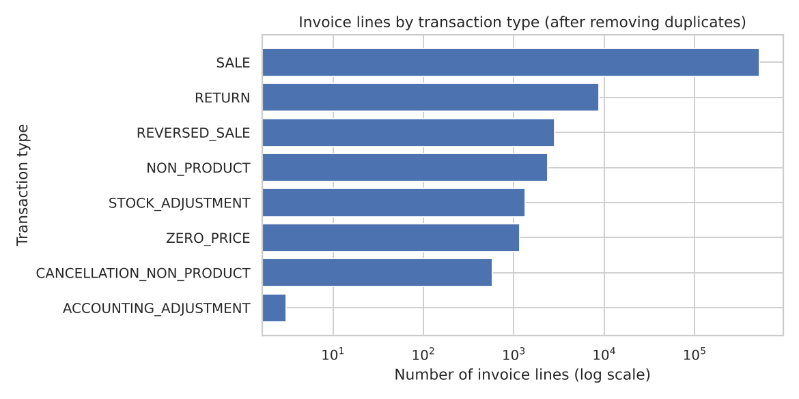

**Interpretation:** 96.8% of lines are genuine product sales. Returns, reversed orders, postage/fees and adjustments are kept out of demand so they do not distort forecasts.

## Daily sales

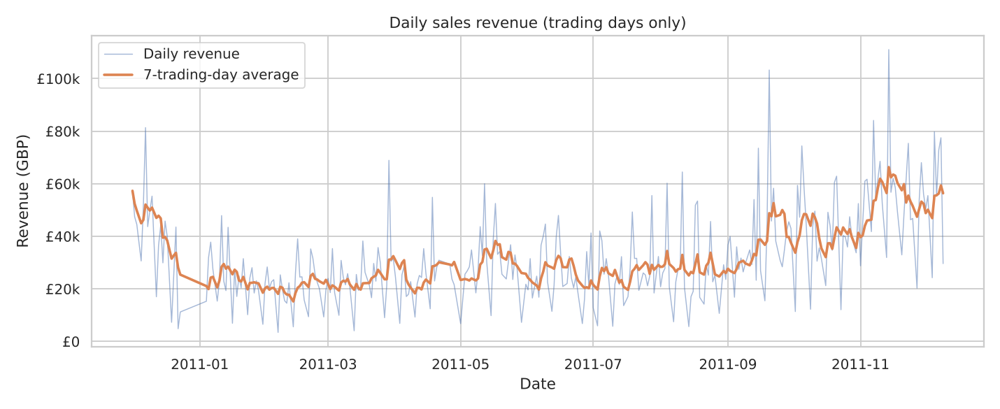

**Interpretation:** Revenue is noisy day to day (busiest day 14 Nov 2011: £111k; daily std = £17k). Average revenue per trading day is highest in December 2011 (£56k), 2.6x the lowest month (February 2011).

## Weekly sales

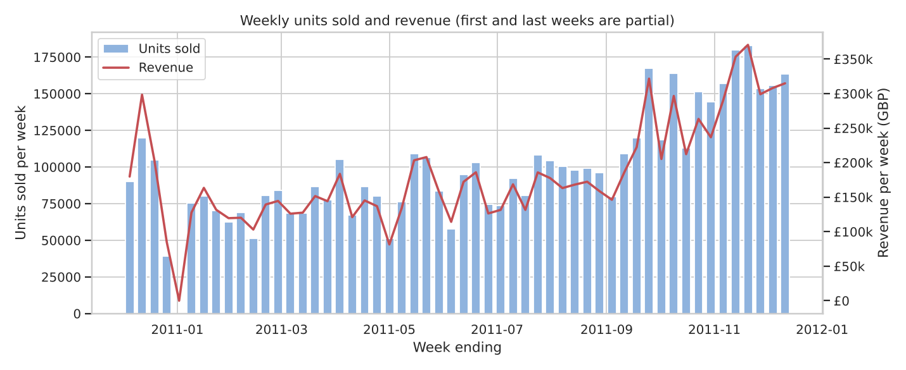

**Interpretation:** Units and revenue move together. Full weeks range from £82k to £371k revenue, so weekly planning must allow for a large swing. 1 week(s) had no trading at all (holiday closure).

## Monthly revenue

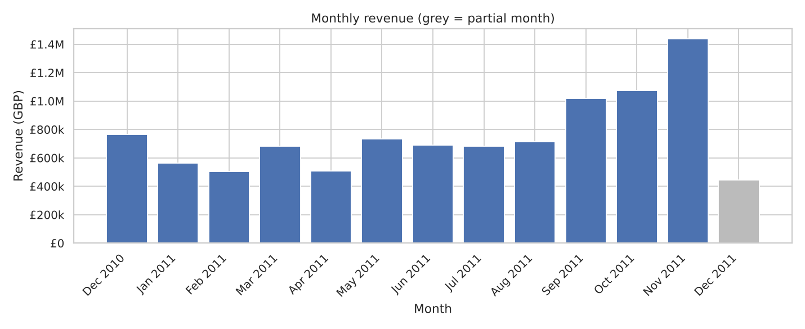

**Interpretation:** Best full month: November 2011 (£1.4M); weakest: February 2011 (£505k). With only ~one year of data this is a single seasonal cycle, so it is described as an observed peak in this period, not a proven yearly pattern.

## Top 10 products by units sold

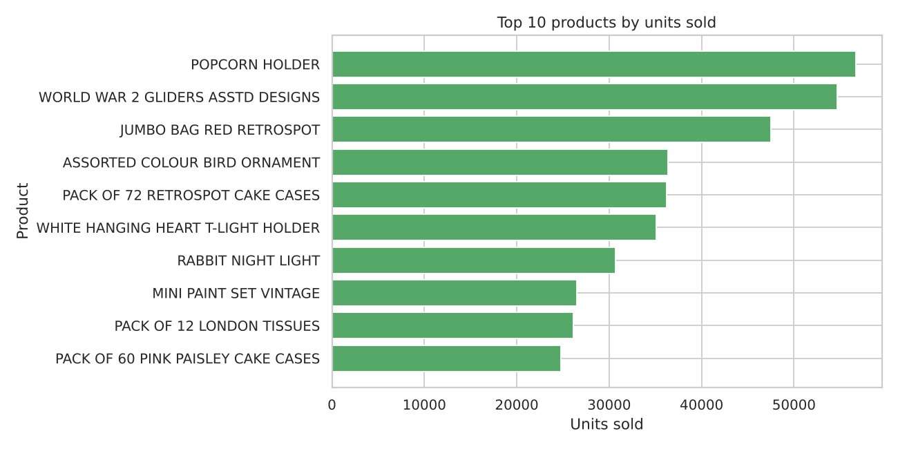

**Interpretation:** 'POPCORN HOLDER' leads with 56,676 units. These 10 products account for 7.0% of all units; their average selling price is £1.17 per unit.

## Top 10 products by revenue

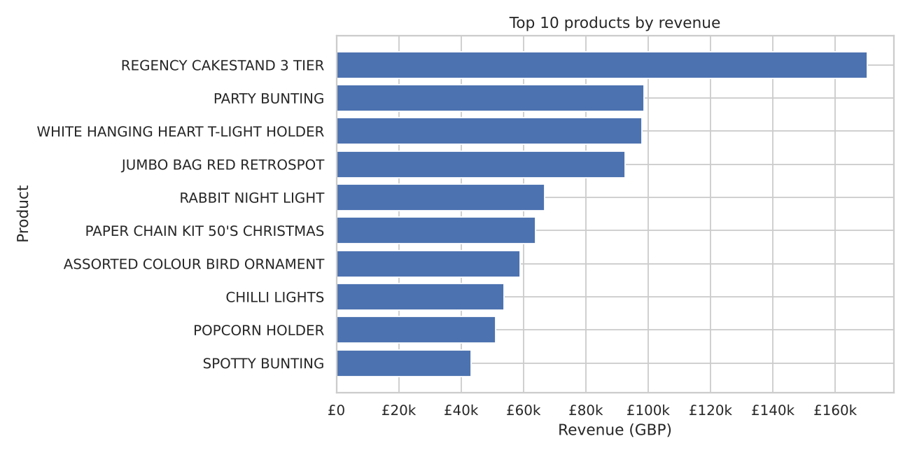

**Interpretation:** 'REGENCY CAKESTAND 3 TIER' leads with 170,229 GBP. These 10 products account for 8.1% of all revenue; their average selling price is £2.89 per unit.

## Product demand variability

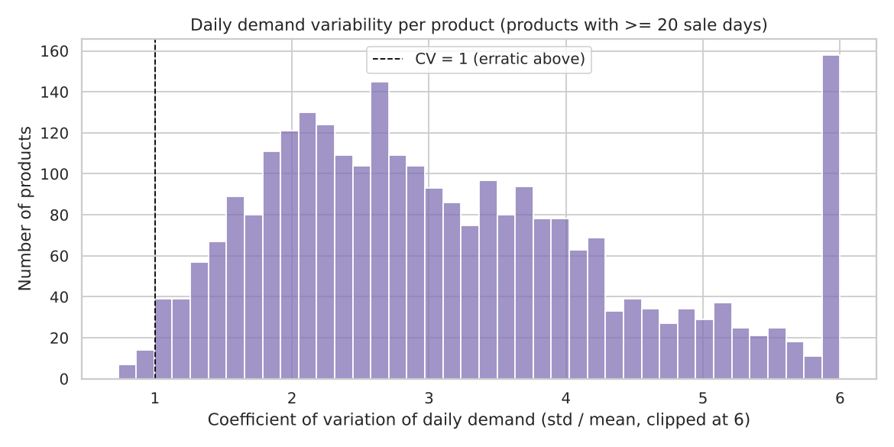

**Interpretation:** 99% of products with >= 20 sale days have CV > 1 (median CV 2.87; median share of trading days with a sale 34%). Daily product demand is intermittent and bursty, so safety stock matters and day-level forecast errors will be large.

## Country-wise revenue

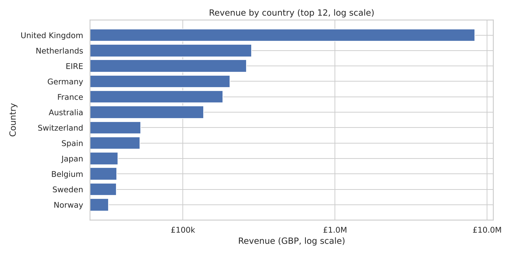

**Interpretation:** United Kingdom generates 84.7% of revenue; a log scale keeps the next markets (Netherlands, EIRE, Germany, France) visible. Demand is dominated by one market.

## Day-of-week pattern

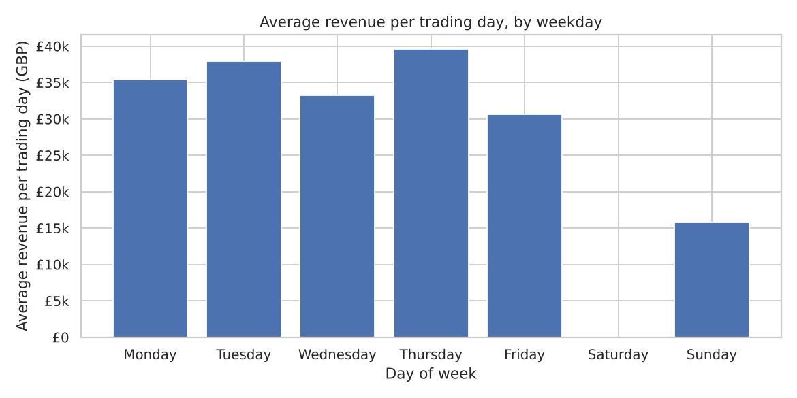

**Interpretation:** Busiest weekday: Thursday; quietest: Sunday. No trading on: Saturday — the forecast treats these as closed days.

## Hourly pattern

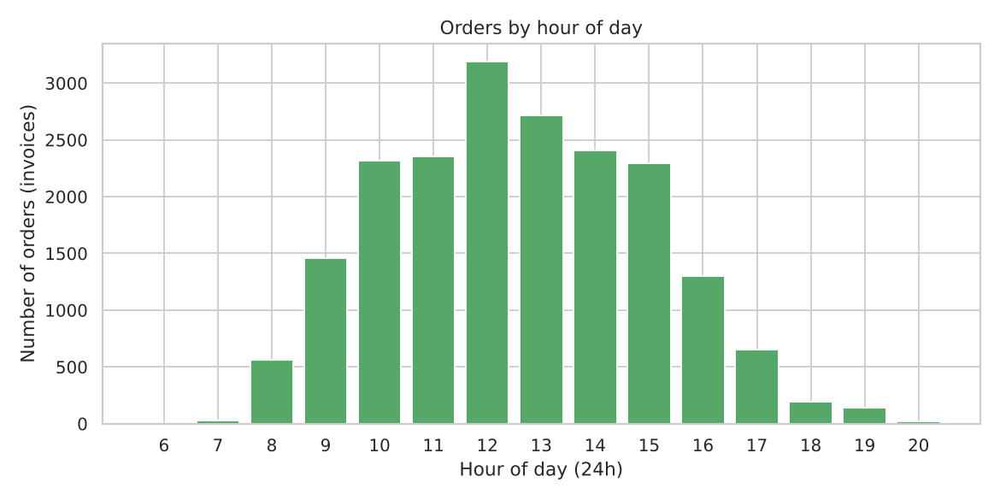

**Interpretation:** Orders peak around 12:00; 98.1% of orders arrive between 08:00 and 17:59 (first hour with orders: 6:00, last: 20:00).

## Customer purchase frequency

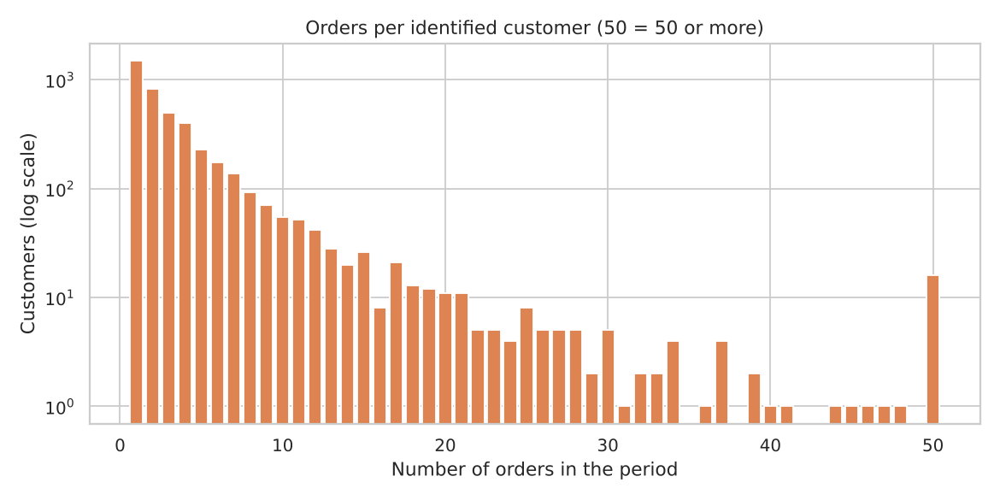

**Interpretation:** 65% of identified customers ordered more than once (median 2 orders, maximum 203). Identified customers generate 84.6% of revenue.
