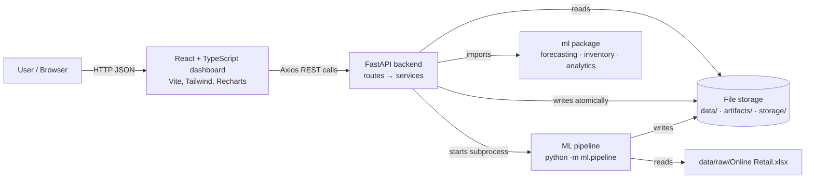
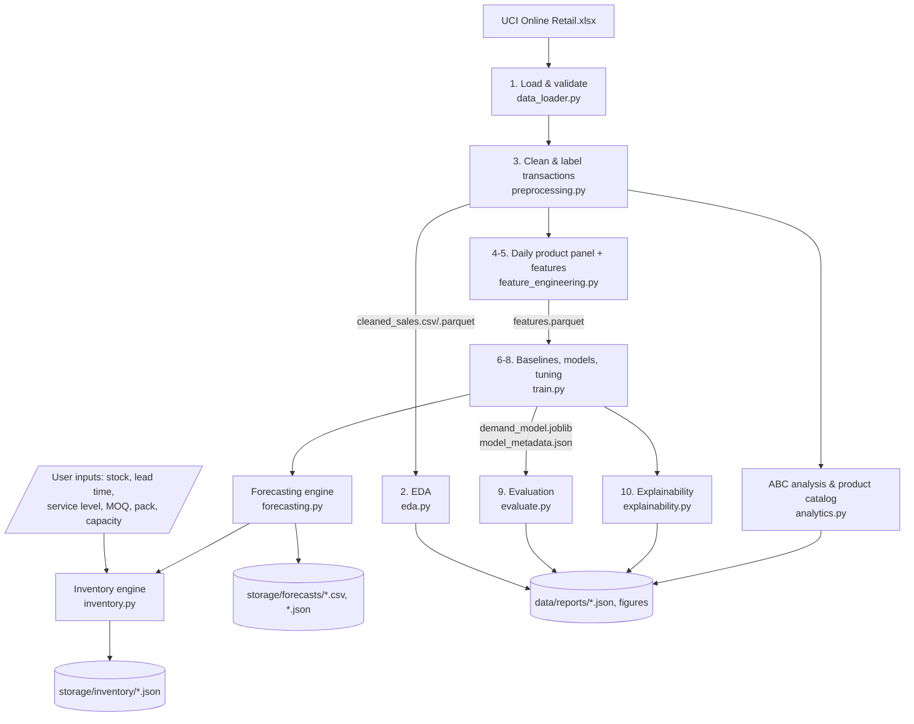
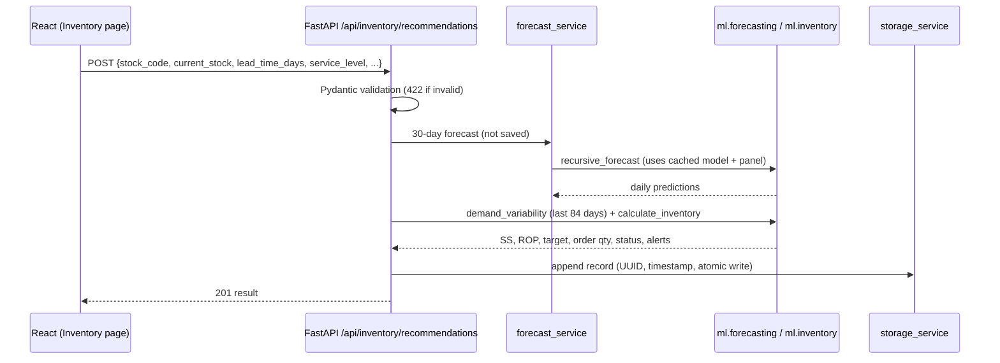

# System Architecture

ForecastIQ is a **single-user local application** with three parts:

1. an **ML pipeline** (`ml/`, plain Python modules)
2. a **FastAPI backend** (`backend/app/`) that serves the pipeline's outputs and runs forecasts and inventory calculations
3. a **React dashboard** (`frontend/`)

**There is no database.** All data lives in files: CSV, JSON, Parquet and Joblib.

## 1. High-level architecture

## 2. Data flow diagram (Level 1)

## 3. ML pipeline

```mermaid
flowchart LR
    S1[Raw transactions<br/>541,909 rows] --> S2[Remove exact duplicates]
    S2 --> S3[Label each row<br/>SALE / RETURN / REVERSED_SALE / ...]
    S3 --> S4[SALE rows → daily units<br/>per product]
    S4 --> S5[Top 500 products<br/>by sale days]
    S5 --> S6[Panel: first→last sale<br/>zero-filled, open/closed flag]
    S6 --> S7[Features with shift 1<br/>lags · rolling · calendar · price · history]
    S7 --> S8[Split by date<br/>70 / 15 / 15]
    S8 --> S9[Baselines + 4 ML models<br/>rolling-origin CV tuning]
    S9 --> S10[Select by validation MAE]
    S10 --> S11[Test once on untouched period]
    S11 --> S12[Refit on all data → demand_model.joblib]
```

## 4. Forecast + inventory request (sequence)

## 5. Backend layering

| Layer | Folder | Responsibility |
|---|---|---|
| Routes | `backend/app/routes/` | HTTP only: parse request, call one service, return result |
| Schemas | `backend/app/schemas/` | Pydantic request/response validation |
| Services | `backend/app/services/` | Business logic, caching, file storage |
| Utils | `backend/app/utils/` | Error types and HTTP error mapping |
| ML core | `ml/` | All data science logic, shared by notebooks, pipeline and API |

## 6. File storage map

| Location | Format | Content | Written by |
|---|---|---|---|
| `data/raw/Online Retail.xlsx` | Excel | Official dataset (git-ignored) | user / upload endpoint |
| `data/processed/online_retail_raw.parquet` | Parquet | Typed cache of the raw file | data_loader |
| `data/processed/cleaned_sales.csv` + `.parquet` | CSV / Parquet | Cleaned SALE rows | preprocessing |
| `data/processed/transactions_classified.parquet` | Parquet | Every row with its TransactionType | preprocessing |
| `data/processed/demand_panel.parquet`, `features.parquet` | Parquet | Product-day panel and model features | feature_engineering |
| `data/processed/test_predictions.parquet` | Parquet | Test-period predictions of every model | train |
| `data/reports/*.json`, `*.md`, `figures/*.png` | JSON / Markdown / PNG | Stage reports and charts | each stage |
| `artifacts/demand_model.joblib` | Joblib | Fitted scikit-learn pipeline + metadata bundle | train |
| `artifacts/model_metadata.json`, `feature_columns.json`, `best_params.json`, `feature_importance.json` | JSON | Model metadata | train / explainability |
| `storage/products/products.json` | JSON | Product catalog with ABC class | analytics |
| `storage/forecasts/forecast_history.csv` + `records/<id>.json` | CSV / JSON | Saved forecasts (append-only) | API |
| `storage/inventory/recommendations.json`, `inventory_inputs.json` | JSON | Saved recommendations and the last inputs per product | API |
| `storage/reports/*.csv`, `*.pdf`, `reports_index.json` | CSV / PDF / JSON | Exported reports | API |
| `storage/settings.json` | JSON | Application settings | API |
| `storage/pipeline_status.json` | JSON | Live pipeline progress | pipeline |

### Reliability rules

- Every write goes to a temporary file first, then `os.replace` swaps it into place. This is an atomic replacement, so a crash can never leave a half-written file.
- Within the backend process, each file has its own lock. The app is a **single-user local application**, and multi-user concurrent writing is out of scope.
- If a JSON file is corrupted, it is moved to `<name>.corrupt-<timestamp>` (kept for manual recovery). A fresh default file replaces it, and a warning appears in `/api/health`.
- Record IDs are UUID4 and every record gets a UTC timestamp. History files are append-only.
- Storage paths are built only from server-generated names. Path traversal (`..`) is rejected.
